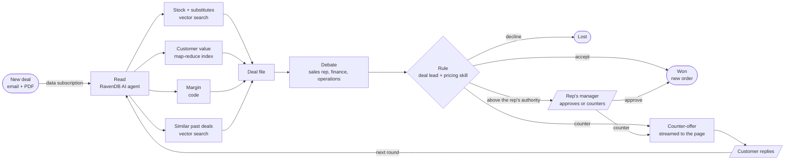

# Northwind Deal Desk

A web app where AI agents negotiate customer orders, on RavenDB's Northwind sample data. It shows most of
[RavenDB.Agents.AI](../../src/RavenDB.Agents.AI/README.md) and [RavenDB.Extensions.VectorData](../../src/RavenDB.Extensions.VectorData/README.md)
working together in one Agent Framework workflow.

The flow isn't a straight line: four checks run in parallel, the team argues, offers go back and forth with the customer,
and a person is asked only when a discount is above the sales rep's authority.

## Run it

You need a licensed RavenDB (AI agents are a licensed feature) and an OpenAI or Azure OpenAI model.

```bash
# RavenDB: RAVEN_URL for your server, or RAVEN_LICENSE (or RAVEN_License_Path) to start an embedded one.
# Model:   OPENAI_API_KEY (and optionally OPENAI_MODEL), or AZURE_OPENAI_ENDPOINT, AZURE_OPENAI_API_KEY, AZURE_OPENAI_DEPLOYMENT.
dotnet run --project samples/RavenDB.Agents.AI.DealDesk
```

Open the URL it prints. The first run creates the database, loads Northwind and sets everything up. To start over with
the embedded server, stop the app and delete the `RavenDB` folder next to it (`bin/Debug/net10.0/RavenDB`).

## Try it (about 6 minutes)

1. **Easy deal.** Click *Easy deal*, then *Send*. Alfreds Futterkiste asks for 3% off coffee and chocolate. Watch the card
   move through the lanes: the four checks fill in at the same time, the team debates, and the deal lead accepts (3% is
   within the rep's 5%). An order appears in the *Won* lane.
2. **The negotiation.** Click *Big negotiation* (Ernst Handel, with a PDF purchase order attached), then *Send*. The agents
   read the order from the PDF, find one product short in stock and the discount below the margin floor, and counter
   with a split shipment or an in-stock substitute. Reply as the customer. The second offer is above the rep's
   authority, so it waits for the rep's manager: click *Approve*, and the deal is won.
3. **Policy is data.** In RavenDB Studio, open the document `AgentSkills/pricing-policy` and change
   "Sales Representative: up to 5%" to 2%. Send the easy deal again: now it needs the manager. No redeploy, no restart.
4. **Look inside.** In Studio, see the deal's revisions (the negotiation step by step), the new order, the agents'
   conversations (`@conversations`), the writer's session (`@AgentSessions`), the deal lead's notes (`@AgentFiles`), the
   workflow checkpoints (`@WorkflowCheckpoints`) and the `deal-desk` subscription.

## How it's built



The workflow waits at the slanted boxes (the customer, the manager). Every step is checkpointed in RavenDB, so the run
resumes from there when the answer arrives, even after a restart. The page follows every deal live through RavenDB's
Changes API.

| Step | What it uses |
|---|---|
| read, debate, counter | `RavenAIAgent`, `RavenAttachment.Copy`, `RunStreamingAsync<T>`, `WithRavenSessionStore()` |
| checks | `RavenVectorStore` (vector search), a RavenDB map-reduce index |
| rule | `RavenAgentSkillsSource`, `RavenAgentFileStore` with `FileMemoryProvider` |
| the whole run | `RavenCheckpointStore`, a RavenDB data subscription, revisions |
